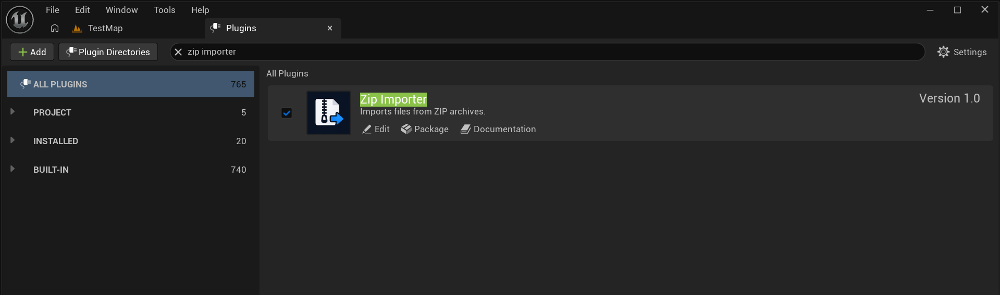

# ZIP Importer

Import ZIP archives into Unreal Engine's Content Browser. Preserve folder structure, process nested ZIP archives, and reimport assets from the original archive.

ZipImporter brings ZIP archive import directly into Unreal Engine's Content Browser. Drag an archive into the destination folder or choose it through the standard Import button. The plugin extracts its contents and sends the files through Unreal Engine's regular asset import system, preserving the folder structure. ZIP archives inside other ZIP archives are processed recursively. Imported assets retain information about their source archive and can be reimported through Unreal Engine's standard Reimport action while the original archive remains available. Supported file types depend on the importers available in the project. ZIP is the only supported archive format; RAR, 7z, and TAR are not supported.

**Available on [Fab](https://www.fab.com/).**

## Contents

- [Features](#features)
- [Installing from Source](#installing-from-source)
- [Using the Plugin](#using-the-plugin)
- [Limitations](#limitations)
- [Building from Source](#building-from-source)

---

## Features

- **Import ZIP archives into the Content Browser.** Drop a ZIP archive onto the destination folder, or use the Content Browser's regular **Import** button.
- **Preserve folder structure.** Directories inside the archive are recreated under the selected Content Browser destination.
- **Import nested ZIP archives.** ZIP files found inside an archive are processed recursively, and their contents are placed in the corresponding subfolders.
- **Use Unreal Engine's import pipeline.** Files are imported using the asset importers available in the project. Supported file types therefore depend on Unreal Engine and the importers installed in the project.
- **Reimport from the original archive.** Imported assets keep information about their source archive and their path inside it, allowing them to be reimported through Unreal Engine's standard reimport action.

## Installing from Source

ZipImporter is distributed with its source code. To use it in a project, add the plugin folder to the project's `Plugins` directory.

1. Close Unreal Engine.
2. Open your project directory and create a `Plugins` folder if it does not exist.
3. Clone the repository into the plugin directory:

   ```bash
   git clone https://github.com/DontFWithTheJ/UnrealEngineZipImporter.git YourProject/Plugins/ZipImporter
   ```

4. Make sure `ZipImporter.uplugin` is located directly inside `YourProject/Plugins/ZipImporter/`.
5. Generate or refresh the project files if required by your IDE.
6. Build your project's **Development Editor** target for your platform.
7. Open the project in Unreal Engine.

After building, enable the plugin through **Edit → Plugins**. The steps are described in [Enable the Plugin](#enable-the-plugin).
## Using the Plugin

### Enable the Plugin

After installing ZipImporter, open your project and:

1. Select **Edit → Plugins** from the Unreal Editor menu.
2. Search for **ZipImporter**.
3. Enable the plugin.
4. Restart the editor if prompted.



### Importing an Archive with Drag and Drop

This is the quickest way to import an archive.

1. Open the **Content Browser**.
2. Select or open the folder where the imported assets should be placed.
3. Find the `.zip` archive in Windows File Explorer.
4. Drag the archive into the selected Content Browser folder and drop it.

ZipImporter extracts the archive and imports its files into that destination. Folders from the archive are recreated automatically, so the internal directory structure is preserved.

### Importing Through the Content Browser

You can also use Unreal Engine's regular **Import** button in the Content Browser:

1. Open the destination folder in the Content Browser.
2. Click **Import**.
3. Select the `.zip` archive.

The archive is processed in the same way as when using drag and drop. This is an alternative workflow; no separate setup is required.

### Nested ZIP Archives

ZIP archives found inside another ZIP archive are imported recursively. Their contents are placed into a subfolder based on the nested archive's name, while directories inside that nested archive are preserved as well.

For example, an archive with this structure:

```text
EnvironmentPack.zip
├── Materials/
│   └── Surface.png
├── Meshes/
│   └── Rock.fbx
└── ExtraAssets.zip
    └── Textures/
        └── Detail.png
```

will be imported with the corresponding folder structure under the destination Content Browser folder.

### Reimporting Assets

ZipImporter stores the source archive path and the file's location inside the archive with each imported asset. This allows Unreal Engine to use its standard **Reimport** action.

To reimport an asset, use the asset's context menu in the Content Browser and select **Reimport** (or the corresponding reimport command available for that asset).

The original ZIP archive must still exist at its stored location. For assets imported from nested archives, the original outer archive and the nested ZIP entry must also remain available. If the source archive was moved or deleted, reimport will fail until the source is restored or the asset is imported again.

### Existing Assets

The importer allows replacement of existing assets. Be careful when importing an archive into a folder that already contains assets with the same package names: those assets may be replaced by the import.

## Limitations

- **ZIP only.** RAR, 7z, TAR, and other archive formats are not supported.
- Files inside the archive must be supported by Unreal Engine's asset import system. Unsupported file types cannot be imported as assets.
- Nested ZIP processing is limited to 8 archive levels.
- An archive can contain up to 10,000 files, and an individual extracted file cannot exceed 512 MB.
- The original ZIP archive must remain accessible if you want to reimport assets later.

## Building from Source

This section explains how to build the plugin in a project and package it for a specific Unreal Engine version. ZipImporter is an Editor plugin and is not intended to be included in a packaged game.

### Building in an Unreal Engine Project

1. Close Unreal Engine.
2. Place the `ZipImporter` folder in the project's `Plugins` directory.
3. Make sure the descriptor is located at `YourProject/Plugins/ZipImporter/ZipImporter.uplugin`.
4. Generate or refresh the project files if required by your IDE.
5. Open the project files in your C++ IDE.
6. Build the **Development Editor** target for the required platform, for example **Win64**.
7. Launch the project. Enable the plugin through **Edit → Plugins** if necessary.

Use this workflow for development, debugging, and testing plugin changes directly in a project.

### Packaging for an Unreal Engine Version with Unreal Automation Tool

To create a standalone plugin package for a specific engine version, use `BuildPlugin` from the Unreal Automation Tool included with that engine version.

On Windows, open Command Prompt and run the following command, replacing the paths with your own:

```bat
"C:\Path\To\UnrealEngine\Engine\Build\BatchFiles\RunUAT.bat" BuildPlugin -Plugin="C:\Path\To\ZipImporter\ZipImporter.uplugin" -Package="C:\Path\To\Output\ZipImporter" -TargetPlatforms=Win64
```

Arguments:

- `RunUAT.bat` — the Unreal Automation Tool script from the engine version you are building for.
- `-Plugin` — the path to `ZipImporter.uplugin`.
- `-Package` — the output directory for the packaged plugin.
- `-TargetPlatforms=Win64` — the Windows 64-bit target platform. Use another supported target platform when required.

When the build finishes, check the `-Package` output directory. It should contain a ready-to-use `ZipImporter` folder with `ZipImporter.uplugin` and the required build files.

To use the package in a project, copy the `ZipImporter` folder to:

```text
YourProject/Plugins/ZipImporter/
```

To install it into a specific engine installation, use that engine's plugin directory, for example:

```text
<UnrealEngine>/Engine/Plugins/Marketplace/ZipImporter/
```

Then open the project and enable the plugin through **Edit → Plugins** if it is not already enabled.

**Important:** use `RunUAT.bat` from the Unreal Engine version you are targeting. A successful build for one engine version does not guarantee compatibility with other versions. If engine APIs have changed, the plugin source may need to be adapted.
